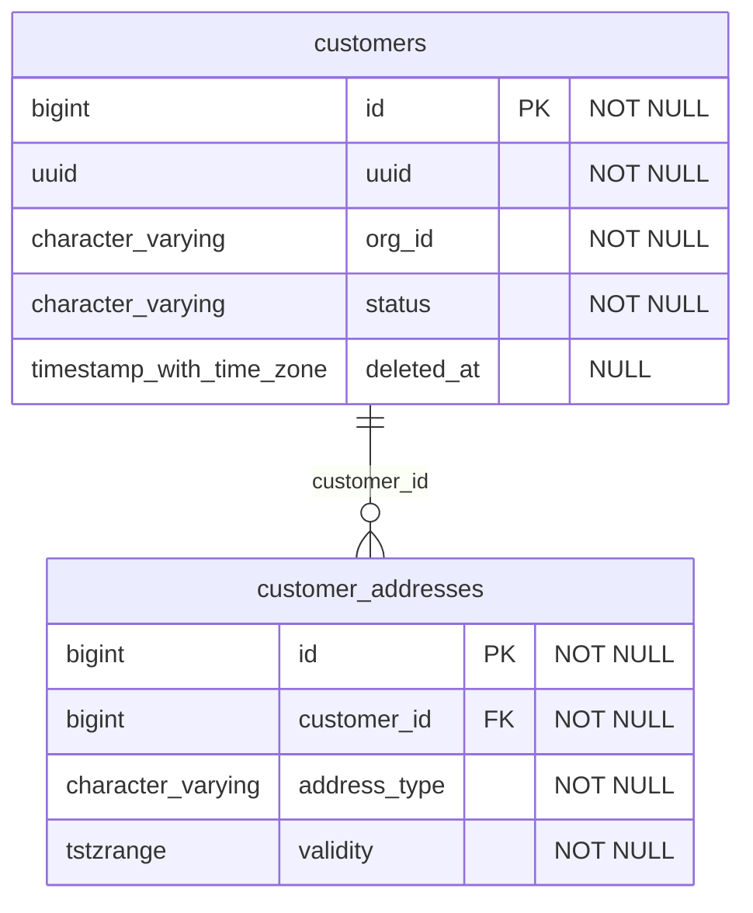

## Step 0 — reuse what the repo already decided

Before querying anything, look for a diagram or a generator the repo already carries:

```bash
ls cc-diagrams/ docs/*erd* scratch/*erd* 2>/dev/null
grep -rln "erDiagram" --include=*.md --include=*.sql . | head
```

An existing `*.sql` generator or diagram file encodes decisions you cannot infer from the schema —
which tables are legacy, which columns are dead, what type names and nullability wording to use.
Read it and carry its exclusions and its formatting into the new file. A schema that still holds v1
tables and a v2 replacement usually wants only one of them drawn; the DB will not tell you which.

When a prior diagram exists and the user names a different output path, generate to the new path but
apply the old file's filters. Do not silently produce a full-schema dump next to a curated one.

## Order of truth

1. **Live database** — always try this first. Types, nullability and FKs are exact.
2. **Migration files** — only when no DB is reachable. Say so in the output header.
3. **ORM entities** (JPA `@Entity`, Prisma schema, Django models, SQLAlchemy) — last resort, and note that generated columns, views and constraints will be missing.

Never mix sources silently. The header states which one was used and when.

## Step 1 — find the connection

Look, in order: `.env` / `.env.dist`, `docker-compose.yml`, `application.properties` / `application.yml`, `settings.py`, project CLAUDE.md. Get host, port, user, database, schema. Container ports often differ from the default — read the compose file rather than assuming 5432/3306.

If the DB is down, offer to start it (`make db`, `docker compose up -d <service>`) before falling back to source.

## Step 2 — dump the schema

Postgres, one schema:

```bash
docker exec <pg-container> psql -U <user> -d <db> -tAF $'\t' -c "
select c.table_name, c.ordinal_position, c.column_name,
       replace(c.udt_name, ' ', '_'), c.is_nullable
from information_schema.columns c
join information_schema.tables t
  on t.table_schema = c.table_schema and t.table_name = c.table_name
where c.table_schema = '<schema>'
order by c.table_name, c.ordinal_position"
```

Foreign keys — from `pg_catalog`, one row per constraint:

```bash
docker exec <pg-container> psql -U <user> -d <db> -tAF $'\t' -c "
select con.conname, child.relname, string_agg(ca.attname, ',' order by k.ord), parent.relname
from pg_constraint con
join pg_class child on child.oid = con.conrelid
join pg_class parent on parent.oid = con.confrelid
join pg_namespace n on n.oid = child.relnamespace
join unnest(con.conkey) with ordinality as k(attnum, ord) on true
join pg_attribute ca on ca.attrelid = con.conrelid and ca.attnum = k.attnum
where con.contype = 'f' and n.nspname = '<schema>'
group by con.conname, child.relname, parent.relname
order by 2, 1"
```

Do **not** read FKs from `information_schema.constraint_column_usage`. Joining it to
`key_column_usage` on `constraint_name` alone is a cartesian product — it returns every referenced
unique-index column against every FK column, so one constraint yields 4 or 18 rows and the FK count
comes out several times too high (a `cis` schema with 37 real FKs reported 125 that way).

Primary keys: same query with `tc.constraint_type = 'PRIMARY KEY'`.

MySQL: same three queries against `information_schema` with `table_schema = database()`.

Pipe the dumps through a script that emits the Mermaid block — do not transcribe hundreds of rows by hand. On a wide schema (40+ tables), process the CSV in code and write only the finished file.

## Step 3 — emit the diagram



Rules that keep Mermaid from choking:

- Type names take no spaces or parens. `character varying` becomes `character_varying`, `timestamp with time zone` becomes `timestamp_with_time_zone`, `numeric(12,2)` becomes `numeric`. Keep the raw `udt_name` and only replace spaces.
- Column line is `<type> <name> [PK|FK|UK] "<comment>"`. Nullability goes in the quoted comment — Mermaid has no nullable marker.
- Several key markers on one column render fine as a comma list (`bigint customer_id PK, FK "NOT NULL"`), verified against mermaid-cli 11.
- Relationship label is the FK column name, quoted. Blank labels render as a stray `:`.
- Cardinality: `||--o{` for a nullable-parent-side FK (one to many), `||--||` when the FK column is also unique, `}o--o{` never — resolve the join table explicitly.
- Schema-qualified names (`cis.customers`) break the parser. Strip the schema prefix and name it in the header.
- Views have no FKs. Include them only when asked, in their own section, and say they are views.

## Step 4 — header and staleness

Every generated file opens with:

```markdown
# <db>.<schema> ER diagram

Mermaid ER of schema `<schema>` (<N> tables, <N> views, <N> columns, <N> FKs).
Source: live DB via `<container>`. **Verified <YYYY-MM-DD>.**
Use it for orientation; for exact types, defaults, CHECKs and indexes query the DB
(`docker exec <container> psql -U <user> -d <db> -c '\d <schema>.<table>'`).
Stale when a new migration lands — recount with
`select count(*) from information_schema.columns where table_schema='<schema>'`.
```

The counts are the staleness test. Someone re-running that one query knows in a second whether the file still matches.

## Step 5 — where the file goes

Follow the repo's own convention for generated analysis files (a CLAUDE.md often names one, e.g. `scratch/cc-*.md`). No convention → `docs/erd.md`. Never the repo root. If a diagram file already exists, update it in place and bump the verified date rather than writing a second one.

## Scoping a big schema

40+ tables in one diagram is unreadable. When the schema is large, ask which cut is wanted, or default to the subset the user named:

- **Domain cut** — tables sharing a prefix or an owning aggregate (`customer_*`, `payment_*`).
- **Neighborhood** — one table plus everything one FK hop away.
- **Core only** — tables with at least one inbound FK; drop leaf lookup tables.

Mention what was left out, with a count.

## Verify before reporting done

Render-check the block, do not eyeball it:

```bash
npx -y @mermaid-js/mermaid-cli -i docs/erd.md -o <scratch>/erd.svg
```

`Could not find chrome-headless-shell (ver. X)` is a missing browser, not a broken diagram. Install
one and point mermaid-cli at it:

```bash
npx -y puppeteer browsers install chrome-headless-shell
printf '{"executablePath":"<path printed above>","args":["--no-sandbox"]}' > <scratch>/pptr.json
npx -y @mermaid-js/mermaid-cli -p <scratch>/pptr.json -i docs/erd.md -o <scratch>/erd.svg
```

The installed version usually differs from the one mermaid-cli pins, which is why the explicit
`executablePath` is needed rather than a second install attempt.

No network or no npx → at minimum grep the block for the known parser traps: a space inside a type, a schema-qualified table name, an empty relationship label, two key markers on one column. Report which check ran.
